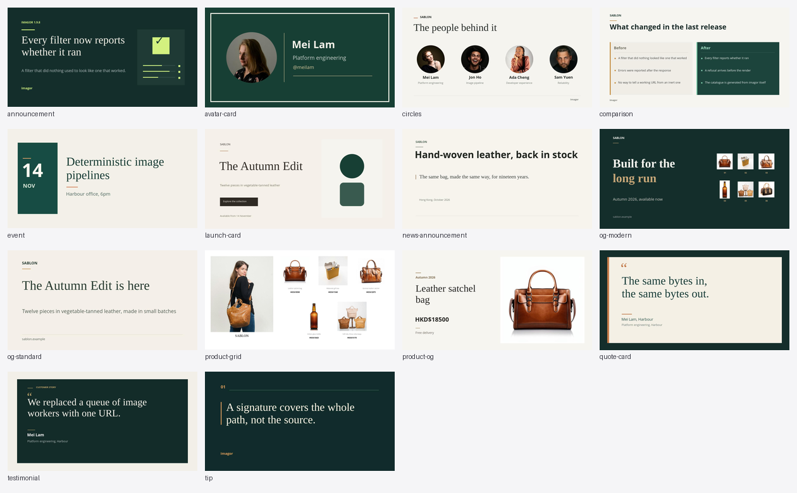

# imagor-mcp

**An MCP server and a skill that add template capability to
[imagor](https://github.com/cshum/imagor).**

An agent writes a layout; the layout compiles to one imagor URL — pasted in a browser,
stored, served from a CDN, put in a page.

[](docs/gallery/cookbook.md)

*Every card above is one imagor URL, composed by an agent from a brief. **[All fourteen,
with the URL each resolves to, and a prompt to ask for it »](docs/gallery/cookbook.md)***

## Quick start

**1. Run an imagor.**

```sh
docker run -d --rm -p 8000:8000 -e IMAGOR_UNSAFE=1 shumc/imagor
```

Unsafe is the local mode, and the one to experiment in: an unsigned URL keeps working after
you change it, so take one the agent built into the browser, edit a coordinate or a word, and
reload — a signed URL will not. Nothing has to match between the server and imagor either.

**2. Install the MCP server.**

```sh
brew trust cshum/tap && brew install imagor-mcp
```

**3. Point a client at it.**

| your client | what to do |
|---|---|
| **VS Code** | **[add it from here](https://vscode.dev/redirect?url=vscode%3Amcp%2Finstall%3F%257B%2522name%2522%253A%2522imagor%2522%252C%2522command%2522%253A%2522imagor-mcp%2522%252C%2522env%2522%253A%257B%2522IMAGOR_UNSAFE%2522%253A%25221%2522%252C%2522IMAGOR_BASE_URL%2522%253A%2522http%253A%252F%252Flocalhost%253A8000%2522%257D%257D)** — one click |
| **Claude Desktop** | open [`imagor-mcp.mcpb`](https://github.com/cshum/imagor-mcp/releases/latest/download/imagor-mcp.mcpb) — one click |
| **Cursor, Claude Code, Windsurf** | add the block below to its config file |
| **Codex** | the same values in TOML, at `~/.codex/config.toml` |

```json
{
  "mcpServers": {
    "imagor": {
      "command": "imagor-mcp",
      "env": { "IMAGOR_UNSAFE": "1", "IMAGOR_BASE_URL": "http://localhost:8000" }
    }
  }
}
```

VS Code keys its servers under `servers` and Codex reads TOML, so the block above fits
neither. Every client's file path, and the shape each one wants, is in
**[docs/clients.md](docs/clients.md)**.

**4. Ask it for something.** Open the **[cookbook](docs/gallery/cookbook.md)** and name a
recipe, or describe the image you want and let it compose.

That is the whole install. It is also on the
[official MCP Registry](https://registry.modelcontextprotocol.io/), where a client can install
it by name, and as `ghcr.io/cshum/imagor-mcp` in a container — which needs a different base
URL, in [Configuration](#configuration). Windows binaries are on the
[releases page](https://github.com/cshum/imagor-mcp/releases).

**Before anything is public, set `IMAGOR_SECRET` on the server and on imagor** — see
[Security](docs/security.md).

## What an agent does with it

A brief like this one:

> *Build a 1200×630 launch card: a deep green ground, a serif headline, a product photo
> on the right, and the price below it. Show me what it looks like.*

It writes the template, renders it, **looks at the image**, and revises. **Given a brief
with no layout, no positions and no sizes, an agent designed three distinct banners
across three runs** — hierarchy, colour, type pairing, invented copy — and zoomed into
regions to read the small text it had drawn.

That is the difference from editor-first image tooling: there is no canvas to design in, and
a URL is something an agent can write, check and rewrite.

## What this adds

**The template layer runs inside your imagor.** Rendering stays in the instance you run, at
the throughput it already has.

**A layout compiles to a URL; a hosted template API returns an image.** Those bill and
transfer the bytes on every render. imagor serves a URL instead, which any browser, proxy or
CDN can cache — so the bytes are transferred once.

## Tools

Each tool maps onto a concept in the imagor path grammar. The list, and what each
is for, is in **[docs/tools.md](docs/tools.md)**.

## The cookbook

`cookbook/` holds **fourteen ready-made layouts** — OG cards, a product grid, a profile
card, quotes, testimonials, an event, a comparison table, a price ladder. Take the
closest, change the values, render it.

**[Every card, and the path it resolves to »](docs/gallery/cookbook.md)** The template is
not on that page: a recipe travels in the server and arrives by name.

Every recipe renders **at three canvas sizes on every commit**, and the contact sheet above
is generated by that same job, so both stay current.

## Configuration

**A mode is required, and exactly one applies** — there is no default. Setting both is
refused at startup, and so is setting neither: they ask for opposite things, and guessing is
how an unsigned setup reaches production.

| Variable | Meaning |
|---|---|
| `IMAGOR_SECRET` | Signing secret. Selects **signed** mode: `<signature>/<path>`. |
| `IMAGOR_UNSAFE` | `1`, `true`, `yes` or `on`. Selects **unsafe** mode: `unsafe/<path>`, development only. Must be explicit. |
| `IMAGOR_BASE_URL` | Your imagor origin, as **you** reach it. Needed for `verify_imagor_url`, and it adds `absolute_url` to output. |
| `IMAGOR_SIGNER_TYPE` | `sha1` (default), `sha256` or `sha512`. |
| `IMAGOR_SIGNER_TRUNCATE` | Signature length in characters. `0` means none. |
| `IMAGOR_MCP_EXTRA_FILTERS` | Extra filter names for forks that register their own. |

The signer settings must match your imagor exactly, or it rejects the URLs.

**Compose in `IMAGOR_UNSAFE`; serve in `IMAGOR_SECRET`.** A signature covers the whole path,
so editing any part of a signed URL invalidates it. Switch when the URL is finished and
something else is going to serve it.

**`IMAGOR_BASE_URL` does two jobs.** It is where the server fetches a render back to verify
it, and it is what the URLs it returns are prefixed with. Both have to be an address *you*
can open, which is why it names `localhost` above and not a container-internal host.

That is the one real cost of running the server in a container. There, the host is
`host.docker.internal` and `localhost` is the container, so the server needs
`-e IMAGOR_BASE_URL=http://host.docker.internal:8000` to work at all — and every URL it hands
you then carries a name your browser cannot resolve. On the host, one address does both
jobs.

### Making previews faster

`verify_imagor_url` fetches through imagor's `preview()` filter, which skips result
storage and opts into the in-memory cache. **Turn the cache on** and repeated looks
at the same composition get much cheaper — measured on a 1600×600 composition,
**386 ms** for the first preview and **25 ms** for a repeat:

```bash
VIPS_CACHE_SIZE=52428800      # byte budget; 0 disables the cache (default)
VIPS_CACHE_MAX_WIDTH=2400     # images larger than this are not cached
VIPS_CACHE_MAX_HEIGHT=2000
```

## Going deeper

The rest of the documentation:

- **[docs/format.md](docs/format.md)** — a template carries no canvas size, and why a path
  cannot be read back into a template.
- **[docs/tools.md](docs/tools.md)** — every tool the server serves, and the prompt.
- **[docs/skill.md](docs/skill.md)** — the skill the server carries, and what it covers.
- **[docs/security.md](docs/security.md)** — what it is trusted with, and what it refuses.
- **[docs/clients.md](docs/clients.md)** — the config file each client reads, and the two that
  key their servers differently.
- **[docs/development.md](docs/development.md)** — building, testing, and the CLI.

## Licence

MIT.
