# Cookbook

Ready-made layouts, each one a single imagor URL. Copy a card's prompt into your agent
and it fetches that recipe and renders it for you.

Each card also carries the URL it resolves to, for rendering without an agent.

[Back to the README](../README.md)

## announcement

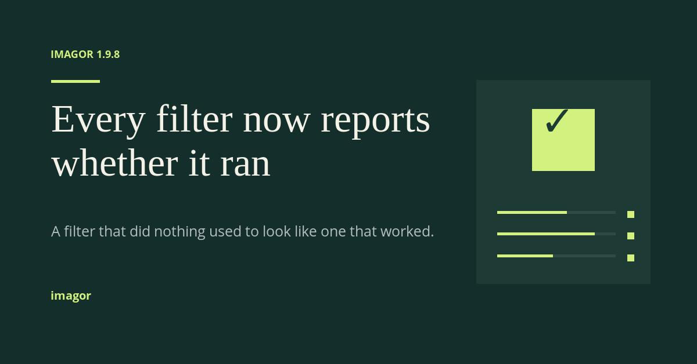

*1200×628* — Headline, one supporting line, one visual. The tech/startup announcement card.

**Ask your agent** — copy this into your client:

```
Use the imagor cookbook recipe announcement, at 1200x628.
```

**Or render it directly:**

```
1200x628/filters:text(b64:SU1BR09SIDEuOS44,88,87,Open-Sans-bold-18,d2f17f):image(84x5/color:d2f17f,88,138):text(b64:RXZlcnkgZmlsdGVyIG5vdyByZXBvcnRzIHdoZXRoZXIgaXQgcmFu,88,179,Liberation-Serif-68,f4f1e8,0,normal,708,low,normal,word):text(b64:QSBmaWx0ZXIgdGhhdCBkaWQgbm90aGluZyB1c2VkIHRvIGxvb2sgbGlrZSBvbmUgdGhhdCB3b3JrZWQu,88,389,Open-Sans-25,b3bec0,0,normal,696,low,normal,word):image(300x352/color:1d3b34,820,138):image(108x107/color:d2f17f,916,188):text(b64:4pyT,940,188,Open-Sans-bold-72,1d3b34):image(204x5/color:2f4a42,856,364):image(120x5/color:d2f17f,856,364):image(12x12/color:d2f17f,1080,364):image(204x5/color:2f4a42,856,401):image(168x5/color:d2f17f,856,401):image(12x12/color:d2f17f,1080,401):image(204x5/color:2f4a42,856,439):image(96x5/color:d2f17f,856,439):image(12x12/color:d2f17f,1080,439):text(imagor,88,502,Open-Sans-bold-20,d2f17f)/color:142e2b
```

## avatar-card


*1200×630* — A landscape profile card with a circular portrait and a left-aligned identity block.

**Ask your agent** — copy this into your client:

```
Use the imagor cookbook recipe avatar-card, at 1200x630.
```

**Or render it directly:**

```
1200x630/filters:image(full-68xfull-68/color:f4f1e8,34,34):image(full-80xfull-80/color:173f34,40,40):image(320x320/filters:smart:round_corner(160,160,173f34)/https://s.imagor.net/photos/photo-1586297135537-94bc9ba060aa.jpg,135,155):image(2x310/color:d8c79b,500,160):text(b64:TWVpIExhbQ,555,207,Open-Sans-bold-64,f4f1e8):text(b64:UGxhdGZvcm0gZW5naW5lZXJpbmc,558,302,Open-Sans-34,cbd4ce):text(b64:QG1laWxhbQ,558,365,Open-Sans-30,d8c79b):image(500x2/color:d8c79b,558,430)/color:173f34
```

## circles

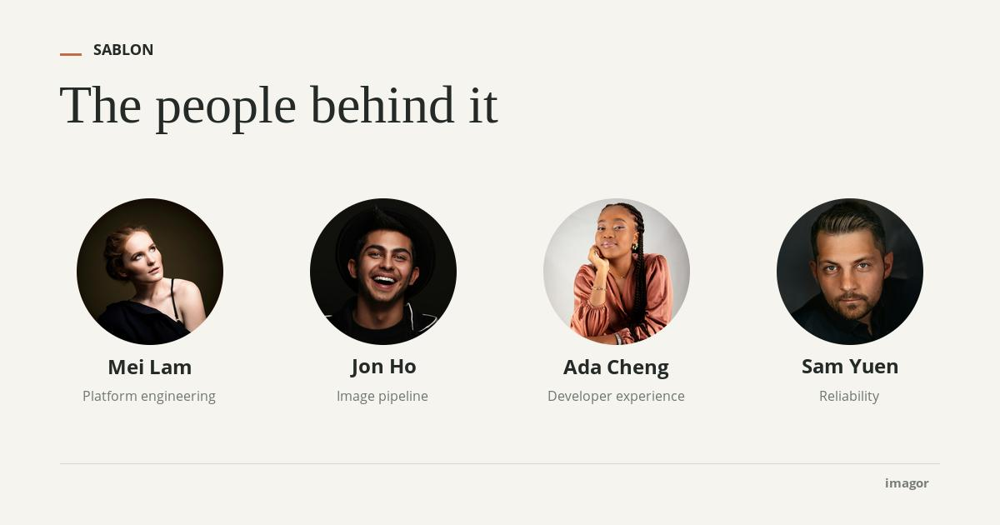

*1200×630* — A row of contributors as circular portraits with names and roles beneath. The portraits should be images on a plain or transparent ground - a source with its own background shows that background as a square block around the circle, which is the source's shape and not a fault in the corner.

**Ask your agent** — copy this into your client:

```
Use the imagor cookbook recipe circles, at 1200x630.
```

**Or render it directly:**

```
1200x630/filters:image(26x3/color:c36c4a,72,64):text(SABLON,112,53,Open-Sans-bold-18,242a27):text(b64:VGhlIHBlb3BsZSBiZWhpbmQgaXQ,72,102,Liberation-Serif-64,242a27,0,normal,full-144,low,normal,word):image(176x176/filters:smart:round_corner(88,88,f6f4ee)/https://s.imagor.net/photos/photo-1654765437547-6b572f52ee1a.jpg,92,238):image(176x176/filters:smart:round_corner(88,88,f6f4ee)/https://s.imagor.net/photos/photo-1595152772835-219674b2a8a6.jpg,372,238):image(176x176/filters:smart:round_corner(88,88,f6f4ee)/https://s.imagor.net/photos/photo-1764103372936-a2c6aceb4233.jpg,652,238):image(176x176/filters:smart:round_corner(88,88,f6f4ee)/https://s.imagor.net/photos/photo-1633625576932-348e73c45e82.jpg,932,238):image(220x83/filters:text(b64:TWVpIExhbQ,center,0,Open-Sans-bold-24,242a27,0,normal,220,center,normal,word):text(b64:UGxhdGZvcm0gZW5naW5lZXJpbmc,center,38,Open-Sans-16,6f7771,0,normal,220,center,normal,word)/color:none,70,431):image(220x83/filters:text(b64:Sm9uIEhv,center,0,Open-Sans-bold-24,242a27,0,normal,220,center,normal,word):text(b64:SW1hZ2UgcGlwZWxpbmU,center,38,Open-Sans-16,6f7771,0,normal,220,center,normal,word)/color:none,350,431):image(220x83/filters:text(b64:QWRhIENoZW5n,center,0,Open-Sans-bold-24,242a27,0,normal,220,center,normal,word):text(b64:RGV2ZWxvcGVyIGV4cGVyaWVuY2U,center,38,Open-Sans-16,6f7771,0,normal,220,center,normal,word)/color:none,630,431):image(220x83/filters:text(b64:U2FtIFl1ZW4,center,0,Open-Sans-bold-24,242a27,0,normal,220,center,normal,word):text(Reliability,center,38,Open-Sans-16,6f7771,0,normal,220,center,normal,word)/color:none,910,431):image(full-144x1/color:d9d6cd,72,556):image(78x30/filters:text(imagor,center,0,Open-Sans-bold-15,777d77,0,normal,78,center,normal,word)/color:none,1050,573)/color:f6f4ee
```

## comparison

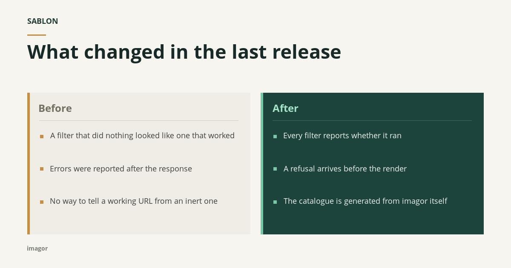

*1200×630* — Two matched columns of points, for a before and after.

**Ask your agent** — copy this into your client:

```
Use the imagor cookbook recipe comparison, at 1200x630.
```

**Or render it directly:**

```
1200x630/filters:text(SABLON,64,43,Open-Sans-bold-18,213d36):image(44x3/color:c58e43,64,81):text(b64:V2hhdCBjaGFuZ2VkIGluIHRoZSBsYXN0IHJlbGVhc2U,64,104,Open-Sans-bold-45,182a27,0,normal,full-128,low,normal,word):image(524x333/color:efede6,64,218):image(524x333/color:1d443c,612,218):image(6x333/color:c58e43,64,218):image(6x333/color:79c7a6,612,218):text(Before,92,245,Open-Sans-bold-24,756f62):text(After,640,245,Open-Sans-bold-24,a5e4c6):image(468x1/color:d1cdc2,92,283):image(468x1/color:45685f,640,283):image(8x8/color:c58e43,94,317):text(b64:QSBmaWx0ZXIgdGhhdCBkaWQgbm90aGluZyBsb29rZWQgbGlrZSBvbmUgdGhhdCB3b3JrZWQ,118,311,Open-Sans-18,3d403b,0,normal,440,low,normal,word):image(8x8/color:79c7a6,642,317):text(b64:RXZlcnkgZmlsdGVyIHJlcG9ydHMgd2hldGhlciBpdCByYW4,666,311,Open-Sans-18,eef4ef,0,normal,440,low,normal,word):image(8x8/color:c58e43,94,393):text(b64:RXJyb3JzIHdlcmUgcmVwb3J0ZWQgYWZ0ZXIgdGhlIHJlc3BvbnNl,118,389,Open-Sans-18,3d403b,0,normal,440,low,normal,word):image(8x8/color:79c7a6,642,393):text(b64:QSByZWZ1c2FsIGFycml2ZXMgYmVmb3JlIHRoZSByZW5kZXI,666,389,Open-Sans-18,eef4ef,0,normal,440,low,normal,word):image(8x8/color:c58e43,94,471):text(b64:Tm8gd2F5IHRvIHRlbGwgYSB3b3JraW5nIFVSTCBmcm9tIGFuIGluZXJ0IG9uZQ,118,465,Open-Sans-18,3d403b,0,normal,440,low,normal,word):image(8x8/color:79c7a6,642,471):text(b64:VGhlIGNhdGFsb2d1ZSBpcyBnZW5lcmF0ZWQgZnJvbSBpbWFnb3IgaXRzZWxm,666,465,Open-Sans-18,eef4ef,0,normal,440,low,normal,word):text(imagor,64,577,Open-Sans-bold-14,7b7e76)/color:f7f5ef
```

## event

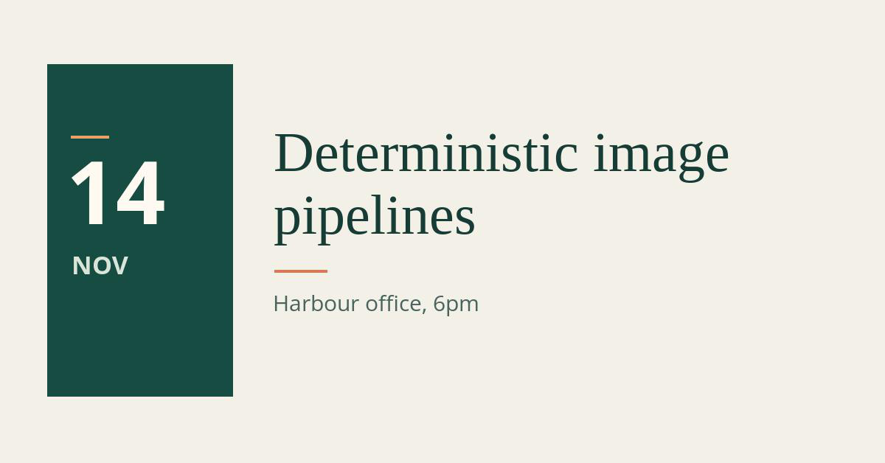

*1200×628* — Date block, title, venue. The open-house / meetup format.

**Ask your agent** — copy this into your client:

```
Use the imagor cookbook recipe event, at 1200x628.
```

**Or render it directly:**

```
1200x628/filters:image(252x451/color:174c43,64,87):image(52x4/color:e6a26b,96,184):text(14,96,219,Open-Sans-bold-118,fffaf1):text(NOV,100,348,Open-Sans-bold-34,d9e5d9):text(b64:RGV0ZXJtaW5pc3RpYyBpbWFnZSBwaXBlbGluZXM,372,181,Liberation-Serif-76,173c36,0,normal,764,low,normal,word):image(72x4/color:d47b54,372,366):text(b64:SGFyYm91ciBvZmZpY2UsIDZwbQ,372,400,Open-Sans-30,49645d)/color:f3f0e8
```

## launch-card

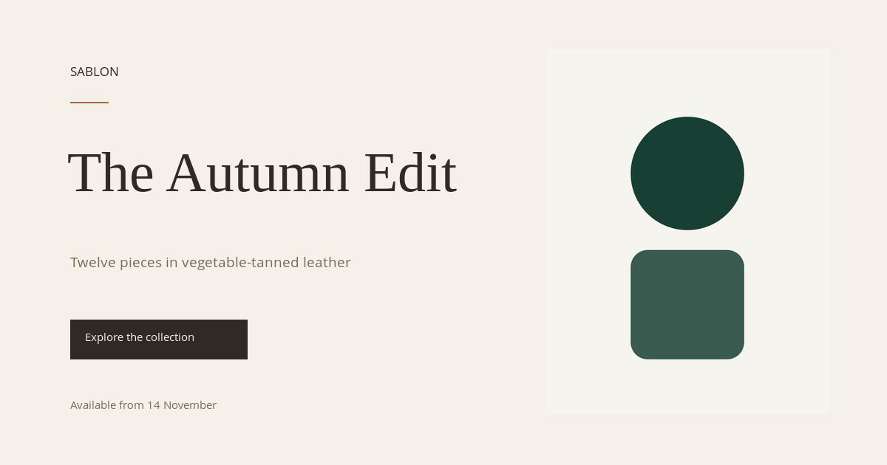

*1200×630* — Editorial split layout for a seasonal accessories collection announcement.

**Ask your agent** — copy this into your client:

```
Use the imagor cookbook recipe launch-card, at 1200x630.
```

**Or render it directly:**

```
1200x630/filters:image(fit-in/384x519/filters:fill(none)/https://s.imagor.net/scene-tall.svg,738,55):text(SABLON,95,91,Open-Sans-17,302a25):image(52x2/color:a7654b,95,138):text(b64:VGhlIEF1dHVtbiBFZGl0,92,206,Liberation-Serif-76,302a25,0,normal,596,low,normal,word):text(b64:VHdlbHZlIHBpZWNlcyBpbiB2ZWdldGFibGUtdGFubmVkIGxlYXRoZXI,95,348,Open-Sans-19,746b61,0,normal,555,low,normal,word):image(240x54/color:302a25,95,433):text(b64:RXhwbG9yZSB0aGUgY29sbGVjdGlvbg,116,451,Open-Sans-15,f5f1e9,0,normal,204,low,normal,word):text(b64:QXZhaWxhYmxlIGZyb20gMTQgTm92ZW1iZXI,95,543,Open-Sans-15,746b61,0,normal,555,low,normal,word)/color:f5f1e9
```

## news-announcement

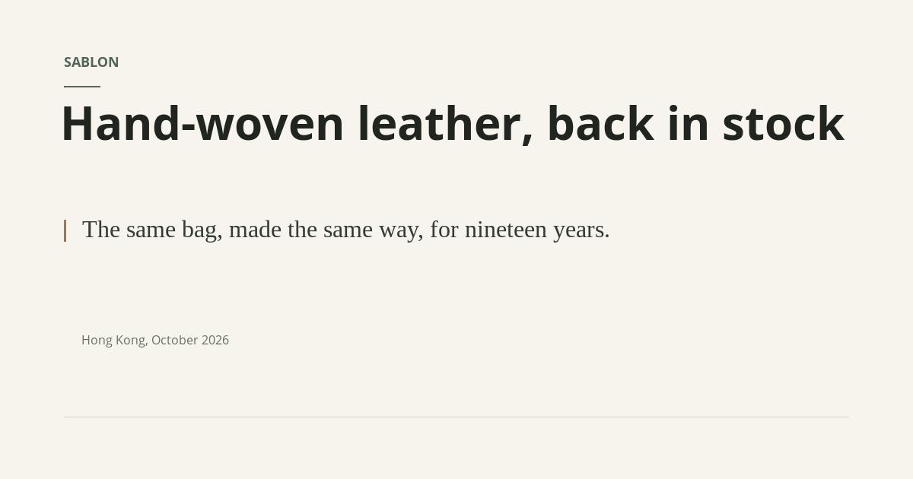

*1200×630* — A restrained, editorial announcement for a product return, pairing a prominent headline with a supporting quote and dateline.

**Ask your agent** — copy this into your client:

```
Use the imagor cookbook recipe news-announcement, at 1200x630.
```

**Or render it directly:**

```
1200x630/filters:text(SABLON,84,75,Open-Sans-bold-18,526653):image(48x2/color:526653,84,113):text(b64:SGFuZC13b3ZlbiBsZWF0aGVyLCBiYWNrIGluIHN0b2Nr,84,138,Open-Sans-bold-60,20251f,0,normal,1032,low,normal,word):image(3x29/color:9a7958,84,289):text(b64:VGhlIHNhbWUgYmFnLCBtYWRlIHRoZSBzYW1lIHdheSwgZm9yIG5pbmV0ZWVuIHllYXJzLg,108,289,Liberation-Serif-32,343b34,0,normal,1008,low,normal,word):text(b64:SG9uZyBLb25nLCBPY3RvYmVyIDIwMjY,108,441,Open-Sans-16,697064):image(1032x1/color:d7d6cc,84,548)/color:f6f4ed
```

## og-modern

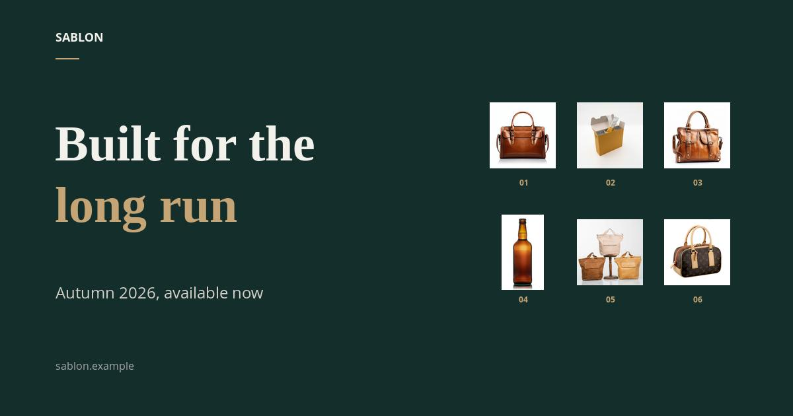

*1200×630* — A dark, restrained Open Graph card with a textured navy ground, split headline, and fitted product grid.

**Ask your agent** — copy this into your client:

```
Use the imagor cookbook recipe og-modern, at 1200x630.
```

**Or render it directly:**

```
1200x630/filters:text(SABLON,84,50,Open-Sans-bold-18,F3F1EC):image(36x2/color:C5A575,84,88):text(b64:QnVpbHQgZm9yIHRoZQ,84,189,Liberation-Serif-bold-76,F3F1EC,0,normal,600,low,normal,word):text(b64:bG9uZyBydW4,84,283,Liberation-Serif-bold-76,C5A575,0,normal,600,low,normal,word):text(b64:QXV0dW1uIDIwMjYsIGF2YWlsYWJsZSBub3c,84,434,Open-Sans-24,D2D0C8,0,normal,576,low,normal,word):text(b64:c2FibG9uLmV4YW1wbGU,84,548,Open-Sans-16,A5A6AA):image(120x151/filters:image(fit-in/100x114/filters:fill(none)/https://s.imagor.net/photos/photo-1691480150204-66dd1eb77391.jpg,9,10):text(01,center,134,Open-Sans-bold-12,C5A575,0,normal,120,center,normal,word)/color:none,732,138):image(120x151/filters:image(fit-in/100x114/filters:fill(none)/https://s.imagor.net/photos/photo-1719488134786-a4c273733931.jpg,9,10):text(02,center,134,Open-Sans-bold-12,C5A575,0,normal,120,center,normal,word)/color:none,864,138):image(120x151/filters:image(fit-in/100x114/filters:fill(none)/https://s.imagor.net/photos/photo-1691480250099-a63081ecfcb8.jpg,9,10):text(03,center,134,Open-Sans-bold-12,C5A575,0,normal,120,center,normal,word)/color:none,996,138):image(120x151/filters:image(fit-in/100x114/filters:fill(none)/https://s.imagor.net/photos/photo-1644085159285-5fd924740cb3.jpg,9,10):text(04,center,134,Open-Sans-bold-12,C5A575,0,normal,120,center,normal,word)/color:none,732,315):image(120x151/filters:image(fit-in/100x114/filters:fill(none)/https://s.imagor.net/photos/photo-1760624294582-5341f33f9fa4.jpg,9,10):text(05,center,134,Open-Sans-bold-12,C5A575,0,normal,120,center,normal,word)/color:none,864,315):image(120x151/filters:image(fit-in/100x114/filters:fill(none)/https://s.imagor.net/photos/photo-1691480288782-142b953cf664.jpg,9,10):text(06,center,134,Open-Sans-bold-12,C5A575,0,normal,120,center,normal,word)/color:none,996,315)/color:142e2b
```

## og-standard

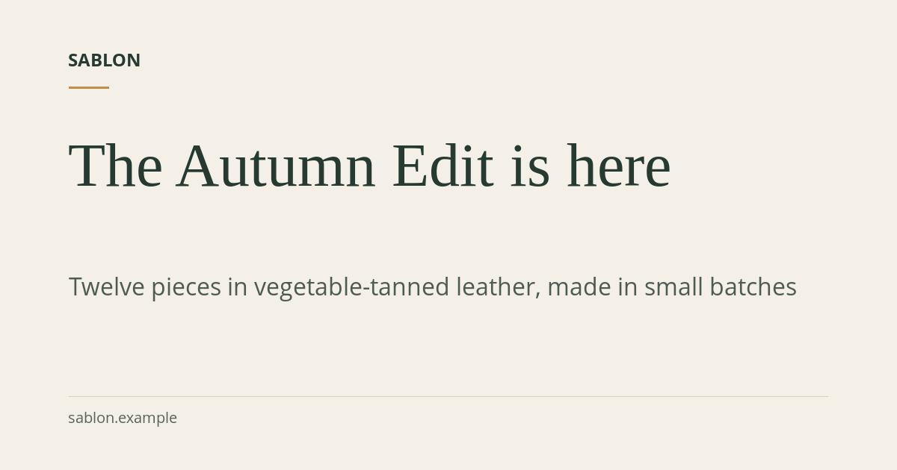

*1200×630* — A text-first 1200x630 Open Graph layout with a small brand mark, prominent title, supporting description, and quiet domain footer.

**Ask your agent** — copy this into your client:

```
Use the imagor cookbook recipe og-standard, at 1200x630.
```

**Or render it directly:**

```
1200x630/filters:text(SABLON,92,72,Open-Sans-bold-24,263a32):image(54x3/color:c58b4b,92,116):text(b64:VGhlIEF1dHVtbiBFZGl0IGlzIGhlcmU,92,192,Liberation-Serif-82,263a32,0,normal,970,low,normal,word):text(b64:VHdlbHZlIHBpZWNlcyBpbiB2ZWdldGFibGUtdGFubmVkIGxlYXRoZXIsIG1hZGUgaW4gc21hbGwgYmF0Y2hlcw,92,371,Open-Sans-32,4e5b52,0,normal,980,low,normal,word):image(1016x1/color:d8d0c1,92,531):text(b64:c2FibG9uLmV4YW1wbGU,92,552,Open-Sans-20,58645b)/color:f4f0e7
```

## product-grid

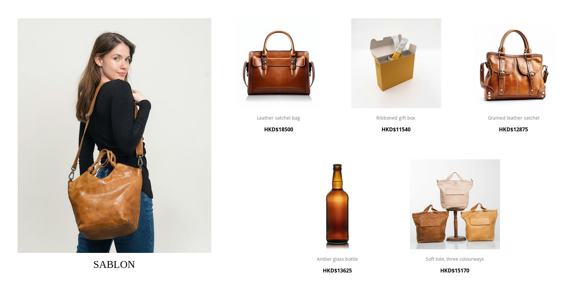

*1800×942* — Lifestyle-led editorial product grid with a tall campaign panel and product captions nested in each image canvas.

**Ask your agent** — copy this into your client:

```
Use the imagor cookbook recipe product-grid, at 1800x942.
```

**Or render it directly:**

```
1800x942/filters:image(594x828/filters:image(594x720/https://s.imagor.net/photos/photo-1760624294469-550753ec203a.jpg,0,0):text(SABLON,center,745,Liberation-Serif-32,000000,0,normal,594,center,normal,word)/color:none,54,56):image(342x395/filters:image(fit-in/342x276/filters:fill(none)/https://s.imagor.net/photos/photo-1691480150204-66dd1eb77391.jpg,0,0):text(b64:TGVhdGhlciBzYXRjaGVsIGJhZw,center,300,Open-Sans-14,777777,0,normal,328,center,normal,word):text(b64:SEtEJDE4NTAw,center,335,Open-Sans-bold-16,000000,0,normal,328,center,normal,word)/color:none,684,56):image(342x395/filters:image(fit-in/342x276/filters:fill(none)/https://s.imagor.net/photos/photo-1719488134786-a4c273733931.jpg,0,0):text(b64:UmliYm9uZWQgZ2lmdCBib3g,center,300,Open-Sans-14,777777,0,normal,328,center,normal,word):text(b64:SEtEJDExNTQw,center,335,Open-Sans-bold-16,000000,0,normal,328,center,normal,word)/color:none,1044,56):image(342x395/filters:image(fit-in/342x276/filters:fill(none)/https://s.imagor.net/photos/photo-1691480250099-a63081ecfcb8.jpg,0,0):text(b64:R3JhaW5lZCBsZWF0aGVyIHNhdGNoZWw,center,300,Open-Sans-14,777777,0,normal,328,center,normal,word):text(b64:SEtEJDEyODc1,center,335,Open-Sans-bold-16,000000,0,normal,328,center,normal,word)/color:none,1404,56):image(342x395/filters:image(fit-in/342x276/filters:fill(none)/https://s.imagor.net/photos/photo-1644085159285-5fd924740cb3.jpg,0,0):text(b64:QW1iZXIgZ2xhc3MgYm90dGxl,center,300,Open-Sans-14,777777,0,normal,328,center,normal,word):text(b64:SEtEJDEzNjI1,center,335,Open-Sans-bold-16,000000,0,normal,328,center,normal,word)/color:none,864,489):image(342x395/filters:image(fit-in/342x276/filters:fill(none)/https://s.imagor.net/photos/photo-1760624294582-5341f33f9fa4.jpg,0,0):text(b64:U29mdCB0b3RlLCB0aHJlZSBjb2xvdXJ3YXlz,center,300,Open-Sans-14,777777,0,normal,328,center,normal,word):text(b64:SEtEJDE1MTcw,center,335,Open-Sans-bold-16,000000,0,normal,328,center,normal,word)/color:none,1224,489)/color:ffffff
```

## product-og

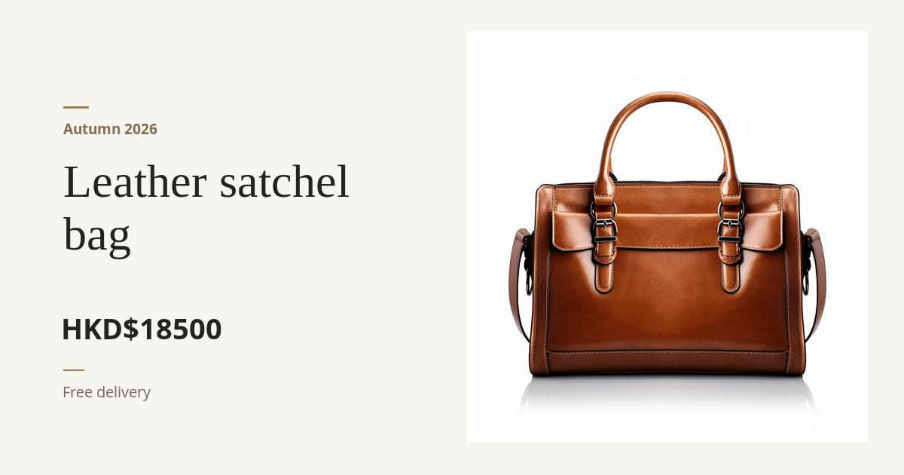

*1200×630* — An editorial product share card with a featured product photograph and concise offer details.

**Ask your agent** — copy this into your client:

```
Use the imagor cookbook recipe product-og, at 1200x630.
```

**Or render it directly:**

```
1200x630/filters:image(532x545/color:ffffff,620,41):image(508x528/https://s.imagor.net/photos/photo-1691480150204-66dd1eb77391.jpg,632,50):image(34x3/color:9b8057,84,141):text(b64:QXV0dW1uIDIwMjY,84,164,Open-Sans-bold-19,806d52):text(b64:TGVhdGhlciBzYXRjaGVsIGJhZw,84,218,Liberation-Serif-62,25231f,0,normal,450,low,normal,word):text(b64:SEtEJDE4NTAw,84,421,Open-Sans-bold-38,25231f):image(28x2/color:9b8057,84,490):text(b64:RnJlZSBkZWxpdmVyeQ,84,512,Open-Sans-20,6e665a)/color:f7f5f0
```

## quote-card

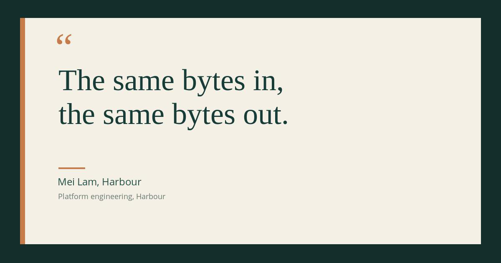

*1200×630* — A pull quote on deep green: the quotation in serif, attributed below a rule.

**Ask your agent** — copy this into your client:

```
Use the imagor cookbook recipe quote-card, at 1200x630.
```

**Or render it directly:**

```
1200x630/filters:image(full-96xfull-88/color:F4F0E6,48,43):image(12xfull-88/color:C57B4A,48,43):text(b64:4oCc,136,81,Liberation-Serif-96,C57B4A):text(b64:VGhlIHNhbWUgYnl0ZXMgaW4sCnRoZSBzYW1lIGJ5dGVzIG91dC4,140,165,Liberation-Serif-72,173C37,0,normal,900,low,normal,word):image(64x4/color:C57B4A,140,401):text(b64:TWVpIExhbSwgSGFyYm91cg,140,426,Open-Sans-24,244F47):text(b64:UGxhdGZvcm0gZW5naW5lZXJpbmcsIEhhcmJvdXI,140,463,Open-Sans-18,687A72)/color:142E2B
```

## testimonial

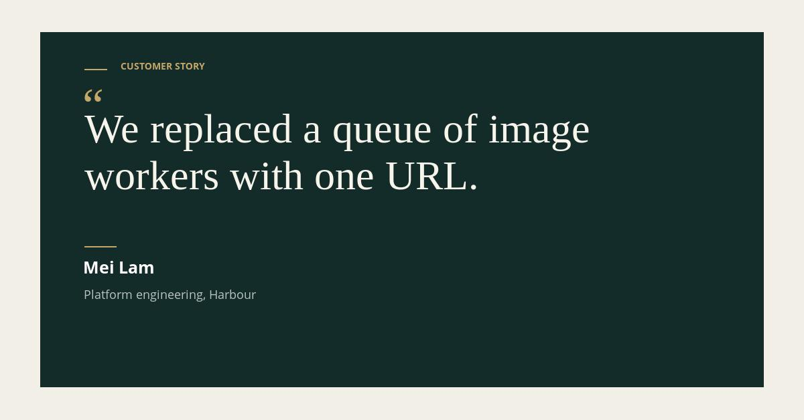

*1200×628* — B2B customer quote with an inset forest panel, warm paper margins and restrained brass accents.

**Ask your agent** — copy this into your client:

```
Use the imagor cookbook recipe testimonial, at 1200x628.
```

**Or render it directly:**

```
1200x628/filters:image(1080x531/color:142c29,60,48):image(34x2/color:c6a76a,126,103):text(b64:Q1VTVE9NRVIgU1RPUlk,180,94,Open-Sans-bold-14,c6a76a):text(b64:4oCc,126,133,Liberation-Serif-72,c6a76a):text(b64:V2UgcmVwbGFjZWQgYSBxdWV1ZSBvZiBpbWFnZSB3b3JrZXJzIHdpdGggb25lIFVSTC4,126,169,Liberation-Serif-62,f7f4ec,0,normal,960,low,normal,word):image(48x2/color:c6a76a,126,368):text(b64:TWVpIExhbQ,126,390,Open-Sans-bold-25,ffffff):text(b64:UGxhdGZvcm0gZW5naW5lZXJpbmcsIEhhcmJvdXI,126,433,Open-Sans-18,b8c4bd)/color:f2efe6
```

## tip


*1200×628* — One actionable tip per card. The educational format.

**Ask your agent** — copy this into your client:

```
Use the imagor cookbook recipe tip, at 1200x628.
```

**Or render it directly:**

```
1200x628/filters:text(01,100,87,Open-Sans-bold-26,e5a15b):image(946x2/color:456a60,154,116):image(5x144/color:e5a15b,100,192):text(b64:QSBzaWduYXR1cmUgY292ZXJzIHRoZSB3aG9sZSBwYXRoLCBub3QgdGhlIHNvdXJjZS4,134,199,Liberation-Serif-70,fff7e8,0,normal,966,low,normal,word):text(imagor,100,509,Open-Sans-bold-22,e5a15b)/color:102c2a
```
